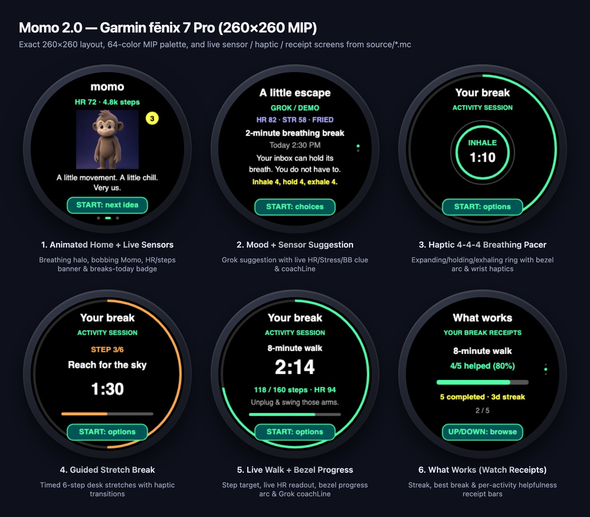
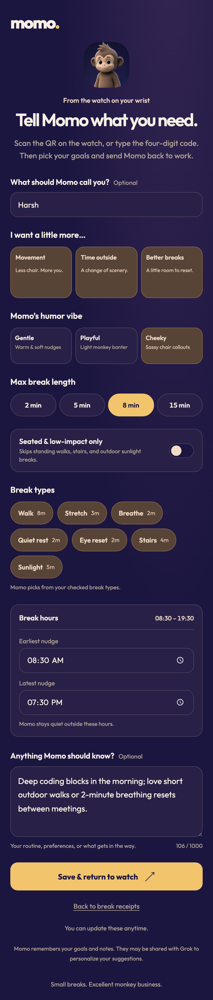
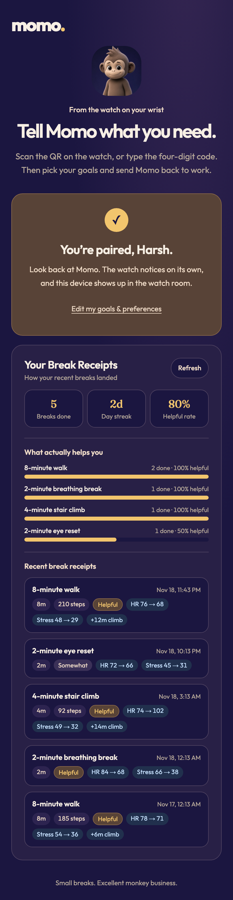
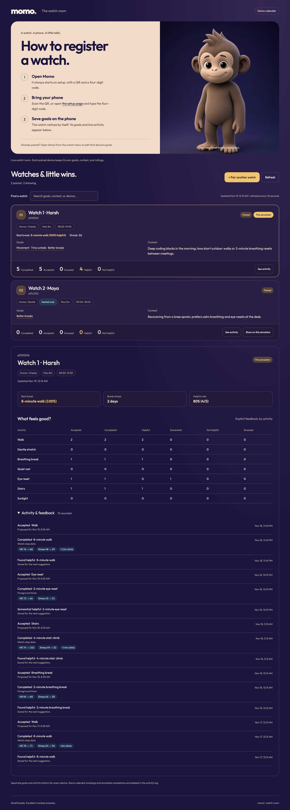

# Momo

A small, slightly cheeky monkey that lives on your **Garmin fēnix 7 Pro** and helps you actually take breaks that work for you.

Garmin watches are great at collecting numbers—steps, heart rate, stress, Body Battery—but most of the time you're left staring at a chart wondering what to do next. Momo turns those signals (plus a quick "how do you feel?" check-in) into short, guided breaks with haptics, animation, and a little humor—then tracks **break receipts** so you can see what genuinely helps.

> **Heads up:** The calendar comes pre-loaded with demo meetings, and demo calendar writes or simulated completions are clearly labeled **DEMO**. Momo never claims medical outcomes or diagnoses stress—watch readings are just context alongside how you say you feel.

---

## On the watch



- **Live watch context + 1-tap check-in:** Pulls available `ActivityMonitor` and `SensorHistory` signals (steps, move bar, heart rate, stress, Body Battery, elevation, temperature, solar) and pairs them with a quick mood check-in (`Fried`, `Okay`, or `Wired`).
- **7 guided break types:** Walk, gentle stretch, 4-4-4 breathing pacer, quiet rest, 20-20-20 eye reset, stair climb, and sunlight break—each with custom 260×260 MIP animations and gentle wrist haptics (`Toybox.Attention`).
- **Grok AI with honest fallback:** Uses xAI's Responses API (`grok-4.7`) to pick an eligible break, explain why it fits your calendar gap, and write a short coaching line. No API key or offline? It switches cleanly to **SCRIPTED** suggestions.
- **Receipts on your wrist:** Open **What works** from the watch menu to see your streak, top-rated break, and per-activity helpfulness bars.

---

## Phone companion & break receipts

Scan the QR code (or type the 4-digit code) shown on Momo when it launches—no account or password needed.

<table>
  <tr>
    <td align="center" width="50%">
      <strong>Personalization</strong><br>
      <sub>Nickname, goals, humor vibe, break length, seated-only mode, break types, and quiet hours.</sub><br><br>
      
    </td>
    <td align="center" width="50%">
      <strong>Your Break Receipts</strong><br>
      <sub>Completed breaks, day streak, helpfulness bars, and before/after vitals from each break.</sub><br><br>
      
    </td>
  </tr>
</table>

---

## The Watch Room (multi-watch admin)

Open `http://127.0.0.1:8787/admin` locally (or `/admin` with your `MOMO_ADMIN_TOKEN` on a public deployment) to see every paired watch, switch which device the simulator points at, and review break ratings and vitals history.



---

## Run locally

You'll need **Node 22+**, **Garmin Connect IQ SDK 9.1.0** with the `fenix7pro` device profile, and a Garmin developer key.

```sh
npm install
cp .env.example .env
```

Optionally set `XAI_API_KEY` in `.env` to turn on live Grok suggestions (`XAI_MODEL` defaults to `grok-4.7`). Without it, Momo runs in **SCRIPTED** mode.

Start the backend + temporary HTTPS tunnel in one terminal:

```sh
npm run calendar:demo
```

Once you see **HTTPS demo ready**, launch the watch app in a second terminal:

```sh
./scripts/ciq.sh run
```

Garmin requires HTTPS for web requests, so `npm run calendar:demo` spins up a temporary Cloudflare Tunnel and writes the build URL + watch access token into gitignored `.local/` and `resources-fenix7pro/`. Keep that terminal running (if you restart it, rebuild the watch so it gets the new tunnel URL).

### Watch controls
- **START:** Get a personalized break suggestion, open action choices (`Let's go`, `Later`, `Something else`, `How I feel`, `Why this?`), or start/finish a break.
- **UP / DOWN:** Cycle home moods or flip through detail & receipt pages.
- **Hold UP:** Open the watch menu (`Next idea`, `Quick check-in`, `What works`, `Setup`, `Controls`).
- **Tap Momo:** Cycle quips on the home screen.

---

## Security & privacy notes

- **One-time pairing:** QR links and 4-digit codes expire after 10 minutes, invalidate each other on use, store only SHA-256 hashes, and rate-limit guesses.
- **Scoped sessions:** A phone browser session can only edit its own wearer's preferences and view its own break receipts—it can't trigger paid AI calls or impersonate a watch.
- **Explicit confirmation:** Grok can only pick from server-validated calendar openings and eligible break types, never sees meeting titles, and can never book a calendar event without your tap on the watch.

---

## Deploy to Vercel

Momo runs as a single Vercel project backed by **Upstash Redis**:

1. Import this repo into Vercel (framework preset: **Other**, root directory: repo root; `vercel.json` routes traffic to `api/index.mjs`).
2. Attach an **Upstash Redis** store (`UPSTASH_REDIS_REST_URL` / `UPSTASH_REDIS_REST_TOKEN`).
3. Set `XAI_API_KEY` (optional), `MOMO_DEVICE_TOKEN`, `MOMO_ADMIN_TOKEN`, and `MOMO_PUBLIC_URL` in Vercel's environment variables. Never put Grok or admin keys in watch resources.
4. Point your local watch build at the deployed URL and launch:

```sh
node scripts/calendar-url.mjs https://your-project.vercel.app
./scripts/ciq.sh run
```

---

## Tests & verification

```sh
npm run calendar:test      # 64 Node backend, AI, sensor, onboarding & workspace tests
./scripts/ciq.sh build     # Build bin/Momo.prg for fēnix 7 Pro (0 warnings)
./scripts/ciq.sh test      # 16 native Connect IQ simulator tests
npm run calendar:smoke     # End-to-end smoke test against the running local demo
```

Add `REQUIRE_GROK=1 npm run calendar:smoke` to assert a real Grok reply when `XAI_API_KEY` is configured.
